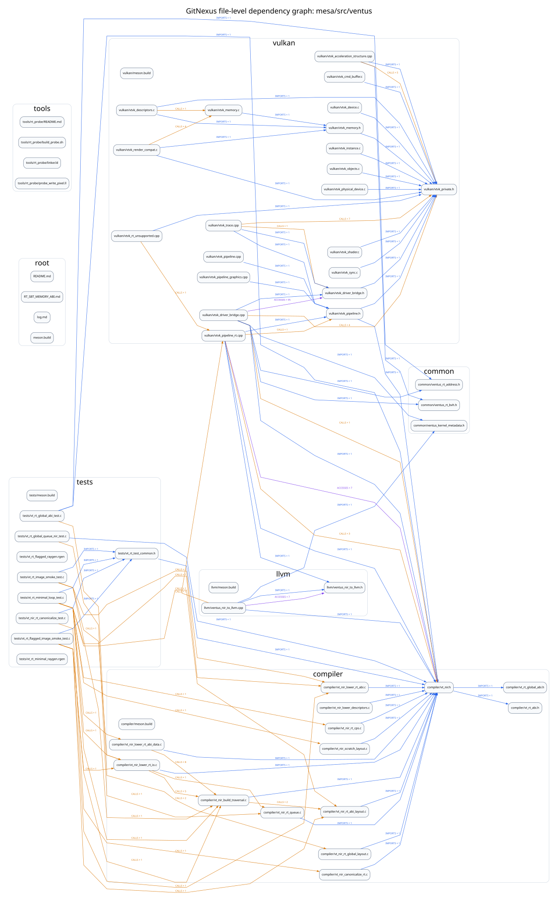

# GitNexus: `mesa/src/ventus` 文件依赖图

索引范围：`mesa/src/ventus`。保留 GitNexus 的 `CALLS`、`IMPORTS`、`ACCESSES` 图关系，并从当前源码补齐内部 C/C++ 带引号 `#include`；交互页会展示实际使用的声明及其间接声明头。

- 文件节点：61（其中 14 个没有已记录的跨文件依赖）
- 跨文件依赖边：90
- 符号级依赖边：143
- 已补齐的内部直接 #include：55
- 橙色：`CALLS`；蓝色：`IMPORTS`；紫色：`ACCESSES`。

## 完整边表

| Source | Relation | Target | Count |
| --- | --- | --- | ---: |
| `compiler/vt_nir_build_traversal.c` | `IMPORTS` | `compiler/vt_nir.h` | 1 |
| `compiler/vt_nir_build_traversal.c` | `CALLS` | `compiler/vt_nir_rt_abi_layout.c` | 2 |
| `compiler/vt_nir_canonicalize_rt.c` | `IMPORTS` | `compiler/vt_nir.h` | 1 |
| `compiler/vt_nir_lower_descriptors.c` | `IMPORTS` | `compiler/vt_nir.h` | 1 |
| `compiler/vt_nir_lower_rt_abi.c` | `IMPORTS` | `compiler/vt_nir.h` | 1 |
| `compiler/vt_nir_lower_rt_abi_data.c` | `IMPORTS` | `compiler/vt_nir.h` | 1 |
| `compiler/vt_nir_lower_rt_abi_data.c` | `CALLS` | `compiler/vt_nir_build_traversal.c` | 8 |
| `compiler/vt_nir_lower_rt_io.c` | `IMPORTS` | `compiler/vt_nir.h` | 1 |
| `compiler/vt_nir_lower_rt_io.c` | `CALLS` | `compiler/vt_nir_build_traversal.c` | 5 |
| `compiler/vt_nir_lower_rt_io.c` | `CALLS` | `compiler/vt_nir_rt_queue.c` | 1 |
| `compiler/vt_nir_rt_abi_layout.c` | `IMPORTS` | `compiler/vt_nir.h` | 1 |
| `compiler/vt_nir_rt_cps.c` | `IMPORTS` | `compiler/vt_nir.h` | 1 |
| `compiler/vt_nir_rt_global_layout.c` | `IMPORTS` | `compiler/vt_nir.h` | 1 |
| `compiler/vt_nir_rt_queue.c` | `IMPORTS` | `compiler/vt_nir.h` | 1 |
| `compiler/vt_nir_scratch_layout.c` | `IMPORTS` | `compiler/vt_nir.h` | 1 |
| `llvm/ventus_nir_to_llvm.cpp` | `ACCESSES` | `llvm/ventus_nir_to_llvm.h` | 7 |
| `llvm/ventus_nir_to_llvm.cpp` | `IMPORTS` | `llvm/ventus_nir_to_llvm.h` | 1 |
| `llvm/ventus_nir_to_llvm.cpp` | `CALLS` | `vulkan/vtvk_pipeline_rt.cpp` | 1 |
| `tests/vt_nir_rt_canonicalize_test.c` | `CALLS` | `compiler/vt_nir_canonicalize_rt.c` | 1 |
| `tests/vt_nir_rt_canonicalize_test.c` | `IMPORTS` | `tests/vt_rt_test_common.h` | 1 |
| `tests/vt_rt_flagged_image_smoke_test.c` | `CALLS` | `compiler/vt_nir_build_traversal.c` | 1 |
| `tests/vt_rt_flagged_image_smoke_test.c` | `CALLS` | `compiler/vt_nir_lower_rt_abi.c` | 1 |
| `tests/vt_rt_flagged_image_smoke_test.c` | `CALLS` | `compiler/vt_nir_lower_rt_io.c` | 1 |
| `tests/vt_rt_flagged_image_smoke_test.c` | `CALLS` | `compiler/vt_nir_rt_abi_layout.c` | 1 |
| `tests/vt_rt_flagged_image_smoke_test.c` | `IMPORTS` | `tests/vt_rt_test_common.h` | 1 |
| `tests/vt_rt_global_abi_test.c` | `CALLS` | `compiler/vt_nir_rt_global_layout.c` | 2 |
| `tests/vt_rt_global_queue_nir_test.c` | `CALLS` | `compiler/vt_nir_rt_queue.c` | 1 |
| `tests/vt_rt_image_smoke_test.c` | `CALLS` | `compiler/vt_nir_build_traversal.c` | 1 |
| `tests/vt_rt_image_smoke_test.c` | `CALLS` | `compiler/vt_nir_lower_rt_abi.c` | 1 |
| `tests/vt_rt_image_smoke_test.c` | `CALLS` | `compiler/vt_nir_lower_rt_io.c` | 1 |
| `tests/vt_rt_image_smoke_test.c` | `IMPORTS` | `tests/vt_rt_test_common.h` | 1 |
| `tests/vt_rt_minimal_loop_test.c` | `CALLS` | `compiler/vt_nir_build_traversal.c` | 1 |
| `tests/vt_rt_minimal_loop_test.c` | `CALLS` | `compiler/vt_nir_lower_rt_abi.c` | 1 |
| `tests/vt_rt_minimal_loop_test.c` | `CALLS` | `compiler/vt_nir_lower_rt_abi_data.c` | 1 |
| `tests/vt_rt_minimal_loop_test.c` | `CALLS` | `compiler/vt_nir_lower_rt_io.c` | 1 |
| `tests/vt_rt_minimal_loop_test.c` | `CALLS` | `compiler/vt_nir_rt_abi_layout.c` | 1 |
| `tests/vt_rt_minimal_loop_test.c` | `CALLS` | `compiler/vt_nir_rt_cps.c` | 1 |
| `tests/vt_rt_minimal_loop_test.c` | `CALLS` | `compiler/vt_nir_scratch_layout.c` | 1 |
| `tests/vt_rt_minimal_loop_test.c` | `IMPORTS` | `tests/vt_rt_test_common.h` | 1 |
| `vulkan/vtvk_acceleration_structure.cpp` | `CALLS` | `vulkan/vtvk_private.h` | 5 |
| `vulkan/vtvk_acceleration_structure.cpp` | `IMPORTS` | `vulkan/vtvk_private.h` | 1 |
| `vulkan/vtvk_cmd_buffer.c` | `IMPORTS` | `vulkan/vtvk_private.h` | 1 |
| `vulkan/vtvk_descriptors.c` | `CALLS` | `vulkan/vtvk_memory.c` | 1 |
| `vulkan/vtvk_descriptors.c` | `IMPORTS` | `vulkan/vtvk_memory.h` | 1 |
| `vulkan/vtvk_descriptors.c` | `IMPORTS` | `vulkan/vtvk_private.h` | 1 |
| `vulkan/vtvk_device.c` | `IMPORTS` | `vulkan/vtvk_private.h` | 1 |
| `vulkan/vtvk_driver_bridge.cpp` | `CALLS` | `compiler/vt_nir.h` | 1 |
| `vulkan/vtvk_driver_bridge.cpp` | `ACCESSES` | `vulkan/vtvk_driver_bridge.h` | 95 |
| `vulkan/vtvk_driver_bridge.cpp` | `IMPORTS` | `vulkan/vtvk_driver_bridge.h` | 1 |
| `vulkan/vtvk_driver_bridge.cpp` | `CALLS` | `vulkan/vtvk_private.h` | 4 |
| `vulkan/vtvk_driver_bridge.h` | `IMPORTS` | `vulkan/vtvk_private.h` | 1 |
| `vulkan/vtvk_instance.c` | `IMPORTS` | `vulkan/vtvk_private.h` | 1 |
| `vulkan/vtvk_memory.c` | `IMPORTS` | `vulkan/vtvk_memory.h` | 1 |
| `vulkan/vtvk_memory.h` | `IMPORTS` | `vulkan/vtvk_private.h` | 1 |
| `vulkan/vtvk_objects.c` | `IMPORTS` | `vulkan/vtvk_private.h` | 1 |
| `vulkan/vtvk_physical_device.c` | `IMPORTS` | `vulkan/vtvk_private.h` | 1 |
| `vulkan/vtvk_pipeline.cpp` | `IMPORTS` | `vulkan/vtvk_pipeline.h` | 1 |
| `vulkan/vtvk_pipeline.h` | `IMPORTS` | `vulkan/vtvk_private.h` | 1 |
| `vulkan/vtvk_pipeline_graphics.cpp` | `IMPORTS` | `vulkan/vtvk_pipeline.h` | 1 |
| `vulkan/vtvk_pipeline_rt.cpp` | `ACCESSES` | `compiler/vt_nir.h` | 7 |
| `vulkan/vtvk_pipeline_rt.cpp` | `CALLS` | `compiler/vt_nir.h` | 3 |
| `vulkan/vtvk_pipeline_rt.cpp` | `CALLS` | `vulkan/vtvk_pipeline.h` | 1 |
| `vulkan/vtvk_pipeline_rt.cpp` | `IMPORTS` | `vulkan/vtvk_pipeline.h` | 1 |
| `vulkan/vtvk_render_compat.c` | `CALLS` | `vulkan/vtvk_memory.c` | 4 |
| `vulkan/vtvk_render_compat.c` | `IMPORTS` | `vulkan/vtvk_memory.h` | 1 |
| `vulkan/vtvk_render_compat.c` | `IMPORTS` | `vulkan/vtvk_private.h` | 1 |
| `vulkan/vtvk_rt_unsupported.cpp` | `CALLS` | `vulkan/vtvk_pipeline_rt.cpp` | 1 |
| `vulkan/vtvk_rt_unsupported.cpp` | `IMPORTS` | `vulkan/vtvk_private.h` | 1 |
| `vulkan/vtvk_shader.c` | `IMPORTS` | `vulkan/vtvk_private.h` | 1 |
| `vulkan/vtvk_sync.c` | `IMPORTS` | `vulkan/vtvk_private.h` | 1 |
| `vulkan/vtvk_trace.cpp` | `CALLS` | `vulkan/vtvk_driver_bridge.h` | 1 |
| `vulkan/vtvk_trace.cpp` | `IMPORTS` | `vulkan/vtvk_driver_bridge.h` | 1 |
| `vulkan/vtvk_trace.cpp` | `IMPORTS` | `vulkan/vtvk_pipeline.h` | 1 |
| `vulkan/vtvk_trace.cpp` | `CALLS` | `vulkan/vtvk_private.h` | 7 |
| `compiler/vt_nir.h` | `IMPORTS` | `compiler/vt_rt_global_abi.h` | 1 |
| `compiler/vt_nir.h` | `IMPORTS` | `compiler/vt_rt_abi.h` | 1 |
| `llvm/ventus_nir_to_llvm.cpp` | `IMPORTS` | `compiler/vt_nir.h` | 1 |
| `llvm/ventus_nir_to_llvm.cpp` | `IMPORTS` | `common/ventus_kernel_metadata.h` | 1 |
| `tests/vt_rt_global_abi_test.c` | `IMPORTS` | `common/ventus_rt_address.h` | 1 |
| `tests/vt_rt_global_abi_test.c` | `IMPORTS` | `compiler/vt_nir.h` | 1 |
| `tests/vt_rt_global_queue_nir_test.c` | `IMPORTS` | `compiler/vt_nir.h` | 1 |
| `tests/vt_rt_test_common.h` | `IMPORTS` | `compiler/vt_nir.h` | 1 |
| `vulkan/vtvk_acceleration_structure.cpp` | `IMPORTS` | `common/ventus_rt_bvh.h` | 1 |
| `vulkan/vtvk_driver_bridge.cpp` | `IMPORTS` | `common/ventus_rt_address.h` | 1 |
| `vulkan/vtvk_driver_bridge.cpp` | `IMPORTS` | `common/ventus_rt_bvh.h` | 1 |
| `vulkan/vtvk_driver_bridge.cpp` | `IMPORTS` | `common/ventus_kernel_metadata.h` | 1 |
| `vulkan/vtvk_driver_bridge.cpp` | `IMPORTS` | `compiler/vt_nir.h` | 1 |
| `vulkan/vtvk_pipeline.h` | `IMPORTS` | `compiler/vt_nir.h` | 1 |
| `vulkan/vtvk_pipeline_rt.cpp` | `IMPORTS` | `compiler/vt_nir.h` | 1 |
| `vulkan/vtvk_pipeline_rt.cpp` | `IMPORTS` | `llvm/ventus_nir_to_llvm.h` | 1 |

## 无跨文件依赖的文件

- `README.md`
- `RT_SBT_MEMORY_ABI.md`
- `compiler/meson.build`
- `llvm/meson.build`
- `log.md`
- `meson.build`
- `tests/meson.build`
- `tests/vt_rt_flagged_raygen.rgen`
- `tests/vt_rt_minimal_raygen.rgen`
- `tools/rt_probe/README.md`
- `tools/rt_probe/build_probe.sh`
- `tools/rt_probe/linker.ld`
- `tools/rt_probe/probe_write_pixel.ll`
- `vulkan/meson.build`
